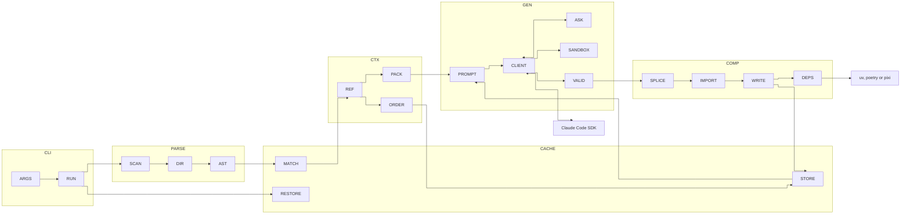
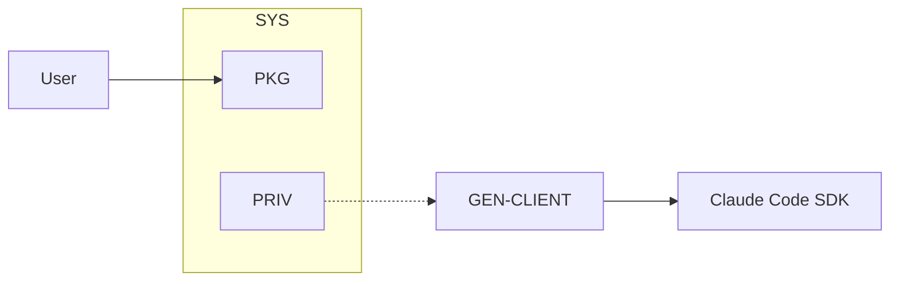
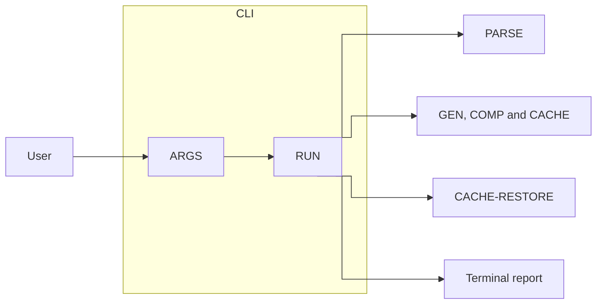
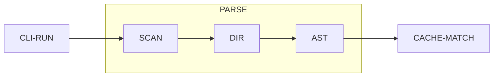
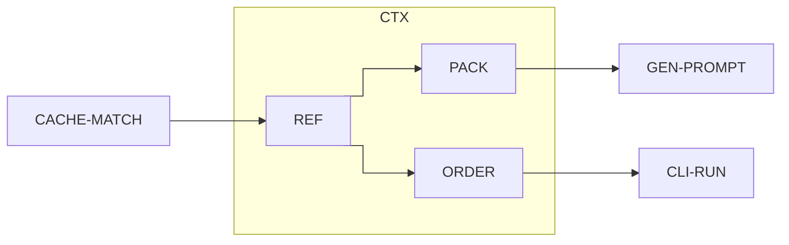
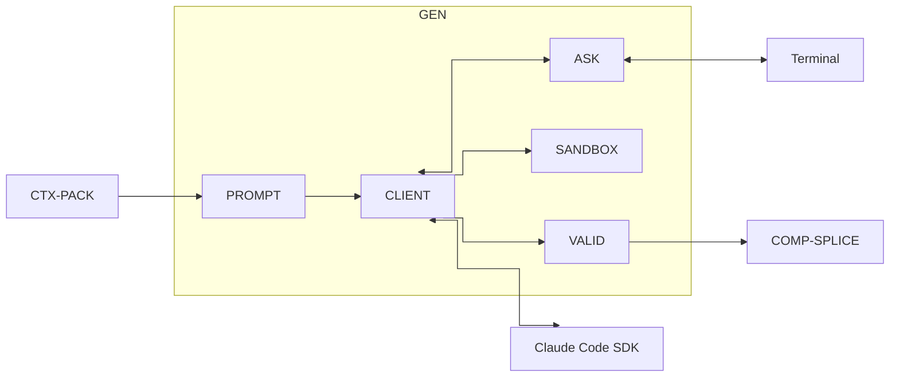
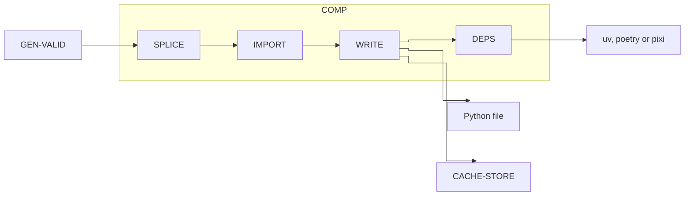
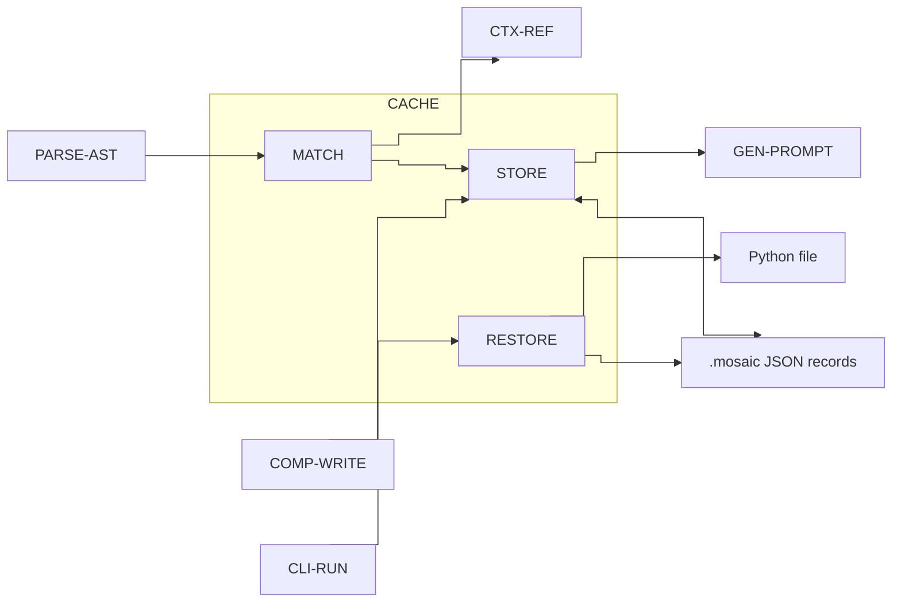
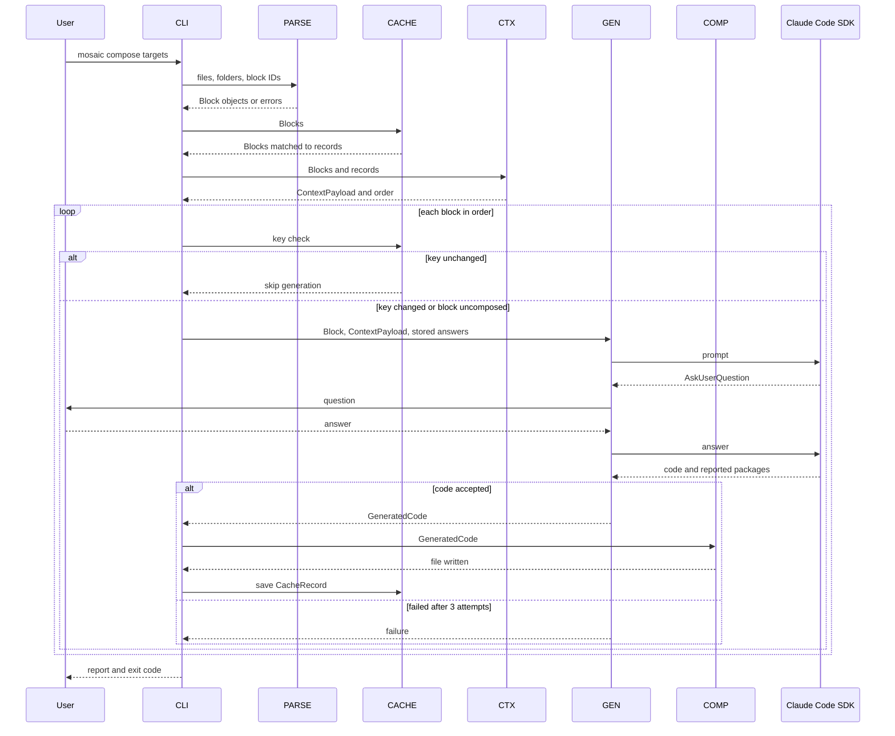

# Detailed Design Specification: Mosaic
Generated: 2026-11-08

## 1. Introduction

This document describes the detailed design of Mosaic. It is based on the SRS and is written for the developers who build and maintain Mosaic and for the reviewers who check that the design meets the requirements.

Mosaic is a Python package with an interactive command-line tool. Users write code as prompts: they mark a stub with Mosaic markers and describe what it should do in its docstring. Mosaic builds context with Python's `ast` module and generates the code with one Claude Code SDK (`claude-agent-sdk`) session per block attempt. It then splices the code back into the file. Mosaic is purely interactive and has no non-interactive or CI mode.

## 2. System architecture

Mosaic has seven components. SYS covers packaging and privacy. CLI reads the command and runs the pipeline. PARSE finds and checks blocks. CTX builds the context and the generation order. GEN asks Claude for code and checks it. COMP writes the code into the file. CACHE keeps one record per block.

CLI-RUN is the only module that knows the order of the steps. Modules exchange plain data objects: Block, Directives, ContextPayload, GeneratedCode and CacheRecord. GEN-CLIENT is the only module that imports `claude-agent-sdk`. COMP-DEPS is the only module that calls a package manager. CACHE-MATCH is the only module that maps blocks in files to cache records.

Main flow: CLI-ARGS, then PARSE (SCAN, DIR, AST), then CACHE-MATCH, then CTX (REF, PACK, ORDER). Then, for each block in order: the CACHE-STORE key check, GEN (PROMPT, CLIENT, ASK, SANDBOX, VALID), COMP (SPLICE, IMPORT, WRITE, DEPS) and the CACHE-STORE save. CLI-RUN prints the report at the end.

| Component | Module | Responsibility |
| --- | --- | --- |
| SYS | PKG | Packaging and running with uv; Python 3.10 and later |
| SYS | PRIV | Credential handling and the limits on what data is sent |
| CLI | ARGS | `mosaic compose <targets...>` with `--model`, `--dry-run` and `--source/--no-source` (on by default); `mosaic restore <targets...>` |
| CLI | RUN | Runs the pipeline, applies the failure rules, prints the final report and sets the exit code |
| PARSE | SCAN | Finds target files (folder search), finds markers, checks block structure and test docstrings |
| PARSE | DIR | Reads the four directives and checks their format and that their targets exist |
| PARSE | AST | Parses files with `ast` and builds block nodes: kind, ID, exact signature, instruction, state (composed or uncomposed) |
| CTX | REF | Finds callers and dependencies from file directives, cached directives and `ast` discovery across the git repo; excludes third-party code |
| CTX | PACK | Builds the YAML tree (callers, dependencies, `#Tests` targets), plus source code when `--source` is on |
| CTX | ORDER | Puts callees first and each class block before its methods, adds uncomposed dependencies, finds cycles |
| GEN | PROMPT | Builds code, class and test prompts: the exact-signature rule, the no-additions rule (with the class `__init__` exception), the AskUserQuestion rule and the package-report rule |
| GEN | CLIENT | One SDK session per block attempt; the user's login and model; 300 s timeout set in code, including time spent waiting for the user; the tool policy |
| GEN | ASK | Shows AskUserQuestion in the terminal and returns the answer to the same session |
| GEN | SANDBOX | Temporary copy of the repo with the candidate code written by Mosaic; OS sandbox with network allowed; the allow-list |
| GEN | VALID | Checks syntax, the one-unit rule, the exact signature and the class rules; up to 3 attempts in total (set in code) |
| COMP | SPLICE | Replaces the directives and stub with the generated code, keeps the markers, leaves all other bytes unchanged |
| COMP | IMPORT | Adds the needed imports at the top of the file without duplicates |
| COMP | DEPS | Adds the third-party packages the model reports with `uv add`, `poetry add` or `pixi add` (dev group for test blocks, no version pins); does nothing and shows no warning in plain projects; warns when an add command fails |
| COMP | WRITE | Checks the whole file is valid Python and overwrites it in place |
| CACHE | MATCH | Matches blocks to records: functions, methods and classes by ID; module-level blocks by instruction hash, then cached-code hash, then position; renumbers `module_<n>` |
| CACHE | STORE | One JSON record per composed block in `.mosaic/` at the git root; computes the cache key; handles skips, hand edits and missing records |
| CACHE | RESTORE | `mosaic restore`: puts back the original stub and directives from the record |

*Diagram: system architecture, showing how the components fit together.*



SYS (PKG and PRIV) applies to the whole system and has no place in the flow.

## 3. Components

### 3.1 SYS: System

SYS holds the rules that apply to the whole package. PKG makes Mosaic installable and runnable with uv on Python 3.10 and later. PRIV keeps credentials out of Mosaic and limits what is sent to Claude. SYS has no code in the main flow; its rules are met by how the other components are built.

*Diagram: SYS architecture.*



**Modules**

| Module | Responsibility |
| --- | --- |
| PKG | Packaging and running with uv; Python 3.10 and later |
| PRIV | Credential handling and the limits on what data is sent |

**Behavior**

1. PKG: Mosaic is a Python package managed with uv. It declares Python 3.10 or later as its minimum version. Version 1 has no public Python API, but its modules can be imported.
2. PRIV: Mosaic never reads, stores, logs or sends credentials. Only the Claude Code SDK and the user's Claude Code login handle authentication. Mosaic has no secrets and no configuration file; configuration is passed as CLI arguments.
3. PRIV: GEN-CLIENT is the only module that talks to the SDK. It sends only the block prompt and the user's answers for that block.

| | |
| --- | --- |
| Inputs | None at run time. |
| Outputs | None at run time. |
| Depends on | uv; Claude Code SDK (for authentication) |
| Requirements | REQ-SYS-PKG-001, REQ-SYS-PKG-002, REQ-SYS-PRIV-001, REQ-SYS-PRIV-002 |

### 3.2 CLI: Command line

CLI is the entry point. It reads the command and its arguments, runs the pipeline in the right order, applies the failure rules and prints the final report. CLI-RUN is the only module that knows the order of the steps.

*Diagram: CLI architecture.*



**Modules**

| Module | Responsibility |
| --- | --- |
| ARGS | Reads `mosaic compose <targets...>` and `mosaic restore <targets...>` and their options; rejects invalid input |
| RUN | Runs the pipeline, applies the failure rules, prints the final report and sets the exit code |

**Behavior**

1. ARGS reads the command with click. `compose` accepts files, folders or block IDs and the options `--model`, `--dry-run` and `--source/--no-source` (on by default). `restore` accepts files or block IDs.
2. ARGS rejects a path that does not exist, a malformed block ID, a block ID that matches no block, or an invalid option. It prints an error, exits with a non-zero code and changes no file.
3. ARGS passes the settings to RUN as a config object. The retry count (3) and the SDK timeout (300 s) are not CLI options; they are set in code.
4. RUN calls PARSE, CACHE-MATCH and CTX for every target. If any marker, block, directive or cycle error exists, it reports every such error and stops before any SDK call.
5. When the SDK reports that Claude Code is not installed or the user is not logged in, RUN stops the whole run with a clear error.
6. With `--dry-run`, RUN prints the generation order and every prompt, makes no SDK call and changes no file.
7. Otherwise RUN processes the blocks one at a time in the order given by CTX-ORDER. Each block is handled on its own. If a block fails, RUN leaves it unchanged and continues.
8. When a block fails, RUN skips every block that depends on it and records why. A method block depends on its class block, so a failed class block skips its methods.
9. For `restore`, RUN calls CACHE-RESTORE for each block named by ID and each composed block in a named file.
10. At the end, RUN reports every failed and skipped block with its reason. It exits with code 0 when every block succeeds and a non-zero code if any block failed or was skipped.

| | |
| --- | --- |
| Inputs | Command line from the user: `compose` or `restore`, targets, and options |
| Outputs | Terminal messages, the final report, and the exit code |
| Depends on | PARSE, CACHE, CTX, GEN, COMP; click |
| Requirements | REQ-CLI-ARGS-001, REQ-CLI-ARGS-002, REQ-CLI-ARGS-003, REQ-CLI-ARGS-004, REQ-CLI-ARGS-005, REQ-CLI-ARGS-006, REQ-CLI-RUN-001, REQ-CLI-RUN-002, REQ-CLI-RUN-003, REQ-CLI-RUN-004, REQ-CLI-RUN-005, REQ-CLI-RUN-006 |

### 3.3 PARSE: Parsing

PARSE turns the target files into Block objects. It runs first in the flow. It finds the blocks, reads their directives and builds a node for each one with `ast`. It reports every structure error with a line number.

*Diagram: PARSE architecture.*



**Modules**

| Module | Responsibility |
| --- | --- |
| SCAN | Finds target files (folder search), finds markers, checks block structure and test docstrings |
| DIR | Reads the four directives and checks their format and that their targets exist |
| AST | Parses files with `ast` and builds block nodes: kind, ID, exact signature, instruction, state |

**Behavior**

1. SCAN searches each given folder recursively for `.py` files. It skips files ignored by `.gitignore` and always skips `.venv`, `.mosaic` and `.git`.
2. SCAN finds every code block between `#MosaicCode:start` and `#MosaicCode:end` and every test block between `#MosaicTest:start` and `#MosaicTest:end`. Markers may be indented.
3. SCAN reports an error with the line number for an unmatched marker, mismatched marker kinds, or a block inside another block.
4. SCAN reports an error when an uncomposed block does not hold exactly one stub: a function, method or class definition whose body is a triple-quoted instruction string, or a module-level triple-quoted instruction string.
5. SCAN reports an error when a test block's docstring has no `Behavior tested:` section or that section is empty.
6. DIR reads `#DependsOn`, `#Calls`, `#CalledBy` and `#Tests` directly under an uncomposed block's start marker. A target is a bare name for the same file or `file.py::Qualified.name` for another file. A directive may list several targets separated by commas or be repeated.
7. DIR reports a structure error with the line number for a malformed or unknown directive, a `#Tests` directive in a code block, or a target that cannot be found.
8. AST parses each file with Python's `ast` module. It reports an error with the line number if the file is not valid Python.
9. AST builds one node per block with: the kind (`def`, `async def` or `class`), the ID, the parameter names in order with annotations and defaults exactly as written, the instruction (uncomposed blocks only) and the state. A parameter with no annotation has no type.
10. AST gives each function, method and class block the ID `file::Qualified.name`, including enclosing classes. It gives each module-level block the ID `file::module_<n>`, numbered in file order.

| | |
| --- | --- |
| Inputs | Files, folders and block IDs from CLI-RUN; Python source files |
| Outputs | A list of Block objects with Directives, or a list of errors with line numbers; passed to CACHE-MATCH |
| Depends on | Python `ast` module; git ignore rules |
| Requirements | REQ-PARSE-SCAN-001, REQ-PARSE-SCAN-002, REQ-PARSE-SCAN-003, REQ-PARSE-SCAN-004, REQ-PARSE-SCAN-005, REQ-PARSE-DIR-001, REQ-PARSE-DIR-002, REQ-PARSE-AST-001, REQ-PARSE-AST-002, REQ-PARSE-AST-003 |

### 3.4 CTX: Context

CTX decides what each block needs to know and the order in which blocks are generated. It runs after CACHE-MATCH and before generation.

*Diagram: CTX architecture.*



**Modules**

| Module | Responsibility |
| --- | --- |
| REF | Finds callers and dependencies from file directives, cached directives and `ast` discovery across the git repo; excludes third-party code |
| PACK | Builds the YAML tree (callers, dependencies, `#Tests` targets), plus source code when `--source` is on |
| ORDER | Puts callees first and each class block before its methods, adds uncomposed dependencies, finds cycles |

**Behavior**

1. REF finds a block's callers as the union of its `#CalledBy` targets (from the file for uncomposed blocks, from the cache record for composed blocks) and the repo code that calls it. The second source is found by static `ast` analysis, by name with import resolution. Calls made in ways `ast` cannot see, such as `getattr`, are not found; this is a known limit.
2. REF finds a block's dependencies as the union of its `#DependsOn` and `#Calls` targets (from the file or the cache record) and the repo code found by `ast` analysis of composed code. It excludes third-party code.
3. PACK builds for each block a YAML tree from `ast` that holds only its callers, its dependencies and its `#Tests` targets. When `--source` is on, PACK also adds the related source code. With `--no-source`, only the YAML is built.
4. ORDER puts each block after the blocks it depends on through `#DependsOn`, `#Calls` or `ast` discovery. `#CalledBy` never affects the order.
5. ORDER makes each method block depend on its class block, so the class block comes first.
6. ORDER reports a cycle between two or more blocks as an error that names the blocks. A function calling itself is not a cycle.
7. When a selected block depends on an uncomposed block that was not selected, ORDER adds that block to the run and CLI-RUN reports that it did so.

| | |
| --- | --- |
| Inputs | Block objects with Directives and cache records, from CACHE-MATCH; the git repo source |
| Outputs | A ContextPayload for each block (YAML tree and optional source), the callers list (used by GEN-CLIENT), and the ordered block list or cycle errors |
| Depends on | PARSE, CACHE-MATCH; Python `ast` module |
| Requirements | REQ-CTX-REF-001, REQ-CTX-REF-002, REQ-CTX-PACK-001, REQ-CTX-ORDER-001, REQ-CTX-ORDER-002, REQ-CTX-ORDER-003, REQ-CTX-ORDER-004, REQ-CLI-ARGS-006 |

### 3.5 GEN: Generation

GEN gets validated code for one block. It builds the prompt, talks to Claude, relays questions to the user and checks the result. It runs once per block, in the order from CTX-ORDER.

*Diagram: GEN architecture.*



**Modules**

| Module | Responsibility |
| --- | --- |
| PROMPT | Builds code, class and test prompts with the rules below |
| CLIENT | One SDK session per block attempt; the user's login and model; timeout; tool policy |
| ASK | Shows AskUserQuestion in the terminal and returns the answer to the same session |
| SANDBOX | Temporary copy of the repo with the candidate code; OS sandbox with network allowed; the allow-list |
| VALID | Checks syntax, the one-unit rule, the exact signature and the class rules; retry limit |

**Behavior**

1. PROMPT builds a prompt for each function, method and module-level block. It holds the instruction, the exact signature (if any), the YAML context, the source when enabled, and the rules that the signature must not change and nothing beyond the stub may be added.
2. PROMPT builds a class prompt that allows class attributes and an `__init__` built from the instruction, and allows no other methods. It allows no `__init__` when an `__init__` method block exists for that class.
3. PROMPT builds a test prompt with the `Behavior tested:` text, the exact signature, the YAML context including the `#Tests` targets, and the source when enabled. It asks for exactly one pytest unit.
4. Every prompt tells the model to use AskUserQuestion whenever it is unsure or anything is ambiguous, and to report each third-party package the code needs.
5. CLIENT opens one SDK session per block attempt, using the user's existing Claude Code login. It sets the model from `--model`, or leaves it unset to use the SDK default.
6. CLIENT ends any SDK call that runs longer than the timeout, including time spent waiting for the user's answers. The timeout defaults to 300 seconds and is set in code. The attempt then counts as failed.
7. For a block with no callers, CLIENT allows the model no tool except AskUserQuestion.
8. For a block with callers, SANDBOX copies the repo to a temporary folder and writes the candidate code into the copy. CLIENT runs the session there with the Claude Code OS sandbox enabled and network access allowed.
9. In that session, the SANDBOX allow-list permits only AskUserQuestion, Read, Grep and Glob on the copy, and Bash limited to `<runner> python -c "import <module>"`. The runner is `uv run`, `poetry run` or `pixi run` to match the project, or plain `python` otherwise. Every other action is denied.
10. When the session ends, SANDBOX deletes the temporary copy. The model makes no change to the user's repo.
11. When the model sends an AskUserQuestion, ASK shows it in the terminal and returns the user's answer to the same block's session. CLIENT returns the answers in the GeneratedCode object so CACHE-STORE can save them.
12. VALID rejects generated code that is not valid Python or that defines more than the one unit of its stub.
13. VALID rejects a generated function or method whose kind, name, parameter names, parameter order, annotations or defaults differ in any way from the stub.
14. VALID rejects a generated class whose name or bases differ from the stub, that defines any method other than `__init__`, or that defines `__init__` when an `__init__` method block exists.
15. VALID counts the attempts. When the code is rejected, or the call times out or hits a network error, GEN tries again in a new session, up to 3 attempts in total (set in code). After a rejection, the new prompt also holds the rejected code and the reason it was rejected. After a timeout or network error, the new prompt is the original one. Either way, the user's stored answers are reused and the same questions are not asked again. After the last attempt GEN returns a failure and the block is left unchanged.

| | |
| --- | --- |
| Inputs | A Block, its ContextPayload, the callers list, the config (model, source flag), the stored user answers, and the user's answers from the terminal |
| Outputs | A GeneratedCode object (validated code, reported packages, user answers) or a failure with its reason; sent to COMP-SPLICE. Prompts and answers go out to the Claude Code SDK. |
| Depends on | CTX-PACK; CACHE-STORE (stored answers); Claude Code SDK and CLI; Claude Code OS sandbox; terminal; uv, poetry or pixi (as the runner inside the sandbox) |
| Requirements | REQ-GEN-PROMPT-001, REQ-GEN-PROMPT-002, REQ-GEN-PROMPT-003, REQ-GEN-PROMPT-004, REQ-GEN-CLIENT-001, REQ-GEN-CLIENT-002, REQ-GEN-CLIENT-003, REQ-GEN-ASK-001, REQ-GEN-SANDBOX-001, REQ-GEN-SANDBOX-002, REQ-GEN-SANDBOX-003, REQ-GEN-VALID-001, REQ-GEN-VALID-002, REQ-GEN-VALID-003, REQ-GEN-VALID-004, REQ-CLI-ARGS-004, REQ-CLI-ARGS-006 |

### 3.6 COMP: Composition

COMP writes validated code into the file. It runs after GEN has accepted the code for a block. It changes only the block and the import section.

*Diagram: COMP architecture.*



**Modules**

| Module | Responsibility |
| --- | --- |
| SPLICE | Replaces the directives and stub with the generated code, keeps the markers, leaves all other bytes unchanged |
| IMPORT | Adds the needed imports at the top of the file without duplicates |
| DEPS | Adds the third-party packages the model reports with the project's package manager |
| WRITE | Checks the whole file is valid Python and overwrites it in place |

**Behavior**

1. SPLICE replaces the block's directives and stub with the validated code. It keeps the markers and their indentation.
2. SPLICE works by splicing text into the file. It does not unparse and rewrite the file, so every byte outside Mosaic blocks stays unchanged, except the imports that IMPORT adds at the top of the file.
3. IMPORT adds the imports the generated code needs at the top of the file. It adds none that are already there.
4. WRITE checks that the final file is valid Python and then overwrites it in place. If the check fails, it leaves the file unchanged and reports an error, and DEPS does not run.
5. After WRITE succeeds, DEPS checks whether the project uses uv, poetry or pixi. If so, it adds each reported third-party package with that tool's `add` command and no version pin. It does not add a package that is already declared.
6. DEPS adds packages reported for test blocks as development dependencies (the dev group).
7. If the project uses none of uv, poetry or pixi, DEPS runs no add command and shows no warning. The import is still added.
8. If an add command fails, DEPS shows a warning that names each package not added and tells the user to add it to the project configuration by hand. The written code is kept and the block counts as a success.

| | |
| --- | --- |
| Inputs | A GeneratedCode object from GEN-VALID; the Python source file |
| Outputs | The updated Python file; changes to the project's dependency file made by the package manager; the result for CACHE-STORE; a warning when an add command fails |
| Depends on | GEN-VALID; the local file system; uv, poetry or pixi |
| Requirements | REQ-COMP-SPLICE-001, REQ-COMP-SPLICE-002, REQ-COMP-IMPORT-001, REQ-COMP-DEPS-001, REQ-COMP-DEPS-002, REQ-COMP-DEPS-003, REQ-COMP-DEPS-004, REQ-COMP-WRITE-001 |

### 3.7 CACHE: Cache

CACHE keeps one JSON record per composed block in `.mosaic/` at the git root. The record is the only copy of a composed block's instruction and directives. CACHE-MATCH is the only module that maps blocks in files to records.

*Diagram: CACHE architecture.*



**Modules**

| Module | Responsibility |
| --- | --- |
| MATCH | Matches blocks to records; renumbers `module_<n>` |
| STORE | Stores one JSON record per composed block; computes the cache key; handles skips, hand edits and missing records |
| RESTORE | `mosaic restore`: puts back the original stub and directives from the record |

**Behavior**

1. MATCH matches each function, method and class block to its record by ID.
2. MATCH matches each module-level block by instruction hash (uncomposed), then by the hash of the cached generated code (composed), then by position. It renumbers `module_<n>` in file order and warns when a match used position only.
3. STORE keeps one JSON record per composed block in `.mosaic/` at the git root. The record holds the block ID, the original stub text, the instruction and its hash, the directives, the cache key, the generated code and its hash, and the user's answers to the model's questions. Mosaic does not require or forbid committing `.mosaic/` and does not edit `.gitignore`.
4. STORE builds the cache key from the instruction, the block signature, the directives, the source of the direct callers and dependencies, and the stored user answers. Unrelated code in the same file does not change the key.
5. When regenerating a composed block, STORE supplies the instruction, stub and directives from the record, and the stored user answers are sent with the prompt.
6. When the cache key is unchanged, STORE tells CLI-RUN to skip generation and keep the code in the file. If that code differs from the cached code, it shows a warning.
7. When the cache key has changed and the code in the file differs from the cached code, STORE warns and asks the user in the terminal before overwriting. If the user declines, the block is left unchanged.
8. When a block holds generated code but has no matching record, STORE reports an error and the block is skipped. The message suggests deleting the code and writing a new stub.
9. After COMP-WRITE succeeds, STORE saves the new record.
10. RESTORE replaces the code of each block named by ID, and of each composed block in a named file, with the original stub and the directives from its record. It keeps the markers and changes nothing else. Only these blocks are restored.
11. RESTORE reports an error and changes no file when a block to be restored has no matching record.

| | |
| --- | --- |
| Inputs | Block objects from PARSE-AST; GeneratedCode and write results from COMP; restore targets from CLI-RUN; the user's overwrite answers from the terminal |
| Outputs | CacheRecord objects (to CTX-REF and GEN-PROMPT); JSON files in `.mosaic/`; restored Python files; warnings and errors |
| Depends on | PARSE-AST; the local file system and the git root; terminal |
| Requirements | REQ-CACHE-MATCH-001, REQ-CACHE-MATCH-002, REQ-CACHE-STORE-001, REQ-CACHE-STORE-002, REQ-CACHE-STORE-003, REQ-CACHE-STORE-004, REQ-CACHE-STORE-005, REQ-CACHE-STORE-006, REQ-CACHE-RESTORE-001, REQ-CACHE-RESTORE-002 |

## 4. Data

Data moves through Mosaic as plain objects: Block, Directives, ContextPayload, GeneratedCode and CacheRecord. The only data that leaves the user's machine is the block prompt and the user's answers for that block, sent to Claude through the Claude Code SDK.

**Block format in the file**
- Code blocks start with `#MosaicCode:start` and end with `#MosaicCode:end`. Test blocks start with `#MosaicTest:start` and end with `#MosaicTest:end`. Markers are indented to match the code they enclose. A block inside another block is an error.
- Each block holds exactly one stub, written as valid Python: a `def` or `async def` function or method whose body is the instruction in a triple-quoted string, a class whose body is the instruction in a triple-quoted string, or, at module level, a single triple-quoted string that holds the instruction.
- A test block holds exactly one function or class stub. Its docstring has a non-empty `Behavior tested:` section. Test blocks can be anywhere in the repo.
- A class block comes first. Each method block follows it, indented, outside the class block's end marker. The class block may generate class attributes and an `__init__`, but no other methods. It generates no `__init__` when an `__init__` method block exists for that class.
- Directives go directly under the start marker, one per line, written `#Directive: targets` with no closing `#`. A target is a bare name for the same file or `file.py::Qualified.name` for another file. A directive can list several targets separated by commas, or be repeated.
- `#DependsOn` and `#Calls` name dependencies. Their targets are added to the context, generated first and included in the cache key.
- `#CalledBy` names callers. Its targets are added to the context and the cache key, and make the block run in the sandbox. It never affects the order.
- `#Tests` is for test blocks only. Its targets are added to the context.
- Functions, methods and classes have the ID `file::Qualified.name`, including enclosing classes (for example `a.py::Dog.get_breed`). Module-level blocks have the ID `file::module_<n>`, numbered in file order.
- An uncomposed block holds the markers, the directives and the stub. After `mosaic compose`, the file holds the markers and the generated code only; the directives and the instruction are kept only in the block's `.mosaic/` record. `mosaic restore` puts them back. To change a composed block, the user runs restore, edits the block, then runs compose. Directives are read from the file for uncomposed blocks and from the record for composed blocks.

A class block followed by one method block:

```python
#MosaicCode:start
class Dog:
    """Dog initialized with breed shepherd."""
#MosaicCode:end
    #MosaicCode:start
    def get_breed(self):
        """Return breed."""
    #MosaicCode:end
```

A test block:

```python
#MosaicTest:start
#Tests: qc.py::get_quality_metrics
def test_get_quality_metrics():
    """
    Behavior tested:
    Quality scores are thresholded on q30 at val < 90.
    """
#MosaicTest:end
```

**Stored**
- `.mosaic/` JSON records at the git root: block ID, original stub text, instruction and its hash, directives, cache key, generated code and its hash, and the user's answers.
- The updated Python source files, written in place.
- The project's dependency file, changed by uv, poetry or pixi when packages are added.

**Not stored**
- Credentials. Mosaic never reads, stores, logs or sends them. Authentication is handled only by the Claude Code SDK and the user's Claude Code login.
- SDK session transcripts.
- The temporary repo copy. It is deleted after each session.

**Sent to Claude**
- Only the block's prompt (instruction, signature, YAML context, and source when `--source` is on) and the user's answers for that block.

*Diagram: data flow.*



## 5. External interfaces

| System | Direction | Content | Authentication |
| --- | --- | --- | --- |
| Claude Code (`claude-agent-sdk` and the Claude Code CLI) | Out and in | Out: prompts, user answers. In: generated code, reported packages, AskUserQuestion requests | The user's own Claude Code login, handled by the SDK |
| Claude Code OS sandbox | Out | Session settings: temporary folder, allow-list, network allowed | None |
| Local file system and git repo | In and out | Python source files, `.mosaic/` JSON records, temporary repo copy | None (OS file permissions) |
| uv, poetry or pixi | Out | `add` commands for packages (dev group for test blocks) | None |
| Terminal (user) | In and out | Questions, answers, overwrite confirmations, warnings, report | None |
