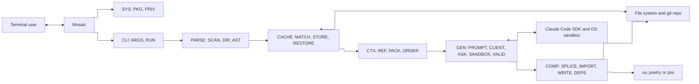

# Software Requirements Specification: Mosaic
Generated: 2026-11-08

## 1. Introduction

This document is the baseline for the design, implementation and testing of Mosaic. Developers use it to design and build the software. Testers use it to write and run test cases. Reviewers use it to check that the software does what it is meant to do.

Mosaic is a Python package with an interactive command-line tool. Users write "code as prompts": they mark a stub with Mosaic markers and describe what it should do in its docstring. Mosaic uses the Claude Code SDK (`claude-agent-sdk`), authenticated with the user's own Claude Code login, to write the code. It then splices the code back into the file.

Version 1 has no public Python API. Mosaic is purely interactive and has no non-interactive or CI mode. Mosaic's own test suite runs in GitHub Actions CI.

Out of scope for version 1: test-driven development pairing, test-first ordering, running tests to validate code, the `#Name` and `#Requires` directives, line-range IDs, and a non-interactive or CI mode.

## 2. Software decomposition

| Component | Module | Responsibility |
| --- | --- | --- |
| SYS | PKG | Packaging and running with uv; Python 3.10+ |
| SYS | PRIV | Credential handling and the limits on what data is sent |
| CLI | ARGS | `mosaic compose <targets...>` with `--model`, `--dry-run` and `--source/--no-source` (on by default); `mosaic restore <targets...>` |
| CLI | RUN | Runs the pipeline, applies the failure rules, prints the final report and sets the exit code |
| PARSE | SCAN | Finds target files (folder search), finds markers, checks block structure and test docstrings |
| PARSE | DIR | Reads the four directives and checks their format and that their targets exist |
| PARSE | AST | Parses files with `ast` and builds block nodes: kind, ID, exact signature, instruction, state (composed or uncomposed) |
| CTX | REF | Finds callers and dependencies from file directives, cached directives and `ast` discovery across the git repo; excludes third-party code |
| CTX | PACK | Builds the YAML tree (callers, dependencies, `#Tests` targets), plus source code when `--source` is on |
| CTX | ORDER | Puts callees first and each class block before its methods, adds uncomposed dependencies, finds cycles |
| GEN | PROMPT | Builds code, class and test prompts: the exact-signature rule, the no-additions rule (with the class `__init__` exception), the AskUserQuestion rule and the package-report rule |
| GEN | CLIENT | One SDK session per block attempt; the user's login and model; 300 s timeout set in code, including time spent waiting for the user; the tool policy |
| GEN | ASK | Shows AskUserQuestion in the terminal and returns the answer to the same session |
| GEN | SANDBOX | Temporary copy of the repo with the candidate code written by Mosaic; OS sandbox with network allowed; the allow-list |
| GEN | VALID | Checks syntax, the one-unit rule, the exact signature and the class rules; up to 3 attempts in total (set in code) |
| COMP | SPLICE | Replaces the directives and stub with the generated code, keeps the markers, leaves all other bytes unchanged |
| COMP | IMPORT | Adds the needed imports at the top of the file without duplicates |
| COMP | DEPS | Adds the third-party packages the model reports with `uv add`, `poetry add` or `pixi add` (dev group for test blocks, no version pins); does nothing and shows no warning in plain projects; warns when an add command fails |
| COMP | WRITE | Checks the whole file is valid Python and overwrites it in place |
| CACHE | MATCH | Matches blocks to records: functions, methods and classes by ID; module-level blocks by instruction hash, then cached-code hash, then position; renumbers `module_<n>` |
| CACHE | STORE | One JSON record per composed block in `.mosaic/` at the git root; computes the cache key; handles skips, hand edits and missing records |
| CACHE | RESTORE | `mosaic restore`: puts back the original stub and directives from the record |

## 3. System overview

Mosaic runs on the user's machine as a command-line tool. CLI-ARGS reads the command and CLI-RUN runs the steps in order. PARSE (SCAN, DIR, AST) finds the blocks in the target files, reads their directives and builds a node for each block. CACHE-MATCH links each block to its record in `.mosaic/`. CTX (REF, PACK, ORDER) finds each block's callers and dependencies, builds its context and sets the generation order. Then, for each block in order, CACHE-STORE checks the cache key, GEN (PROMPT, CLIENT, ASK, SANDBOX, VALID) gets validated code from Claude, COMP (SPLICE, IMPORT, WRITE, DEPS) writes it into the file and adds any new packages, and CACHE-STORE saves the record. CLI-RUN prints the report at the end. For `mosaic restore`, CLI-RUN calls CACHE-RESTORE. SYS (PKG, PRIV) sets rules for the whole package and has no place in the flow.

Mosaic works with five external systems: Claude Code (`claude-agent-sdk` and the Claude Code CLI), the Claude Code OS sandbox, the local file system and git repo, the uv, poetry or pixi package manager, and the user's terminal.

*Diagram: system context.*

## 4. Requirements

| ID | Type | Requirement |
| --- | --- | --- |
| REQ-SYS-PKG-001 | Non-functional | The software shall be a Python package that can be installed and run with uv. |
| REQ-SYS-PKG-002 | Non-functional | The software shall support Python 3.10 and later. |
| REQ-SYS-PRIV-001 | Non-functional | The software shall not read, store, log or send user credentials. Authentication shall be handled only by the Claude Code SDK. |
| REQ-SYS-PRIV-002 | Non-functional | The software shall send to the Claude Code SDK only the block prompt and the user's answers for that block. |
| REQ-CLI-ARGS-001 | Functional | The software shall provide `mosaic compose`, which accepts one or more files, folders or block IDs, and the options `--model`, `--dry-run` and `--source/--no-source`. |
| REQ-CLI-ARGS-002 | Functional | The software shall provide `mosaic restore`, which accepts one or more files or block IDs. |
| REQ-CLI-ARGS-003 | Functional | The software shall reject a path that does not exist, a malformed block ID, a block ID that matches no block, or an invalid option. It shall print an error, exit with a non-zero code and change no file. |
| REQ-CLI-ARGS-004 | Functional | The software shall use the model given by `--model` for every SDK session, and the SDK default model when `--model` is not given. |
| REQ-CLI-ARGS-005 | Functional | With `--dry-run`, the software shall print the generation order and every prompt, make no SDK call and change no file. |
| REQ-CLI-ARGS-006 | Functional | The software shall include the related source code in prompts unless `--no-source` is given. |
| REQ-CLI-RUN-001 | Functional | The software shall process every selected block and exit with code 0 when every block succeeds. |
| REQ-CLI-RUN-002 | Functional | The software shall process each block on its own. A block's failure shall not change the processing of any block that does not depend on it. |
| REQ-CLI-RUN-003 | Functional | When any marker, block, directive or cycle error exists, the software shall report every such error and stop before any SDK call. |
| REQ-CLI-RUN-004 | Functional | When Claude Code is not installed or the user is not logged in, the software shall stop the whole run with a clear error. |
| REQ-CLI-RUN-005 | Functional | When a block fails, the software shall skip every block that depends on it and report why each one was skipped. |
| REQ-CLI-RUN-006 | Functional | At the end of a run, the software shall report every failed and skipped block with its reason, and exit with a non-zero code if any block failed or was skipped. |
| REQ-PARSE-SCAN-001 | Functional | The software shall search each given folder recursively for `.py` files. It shall skip files ignored by `.gitignore` and always skip `.venv`, `.mosaic` and `.git`. |
| REQ-PARSE-SCAN-002 | Functional | The software shall find every code block between `#MosaicCode:start` and `#MosaicCode:end`, and every test block between `#MosaicTest:start` and `#MosaicTest:end`, including indented markers. |
| REQ-PARSE-SCAN-003 | Functional | The software shall report an error with the line number for an unmatched marker, mismatched marker kinds, or a block inside another block. |
| REQ-PARSE-SCAN-004 | Functional | The software shall report an error when an uncomposed block does not contain exactly one stub: a function, method or class definition whose body is a triple-quoted instruction string, or a module-level triple-quoted instruction string. |
| REQ-PARSE-SCAN-005 | Functional | The software shall report an error when a test block's docstring has no `Behavior tested:` section or that section is empty. |
| REQ-PARSE-DIR-001 | Functional | The software shall read the `#DependsOn`, `#Calls`, `#CalledBy` and `#Tests` directives under an uncomposed block's start marker. Targets may be comma-separated or the directive repeated, and may be bare same-file names or `file.py::Qualified.name` names. |
| REQ-PARSE-DIR-002 | Functional | The software shall report as a structure error a malformed or unknown directive, a `#Tests` directive in a code block, or a directive target that cannot be found. |
| REQ-PARSE-AST-001 | Functional | The software shall parse each file with Python's `ast` module and build, for each block, a node holding its kind, its ID, its parameter names in order with annotations and defaults exactly as written, its instruction (uncomposed blocks only) and its state (composed or uncomposed). Parameters with no annotation shall have no type. |
| REQ-PARSE-AST-002 | Functional | The software shall give each function, method and class block the ID `file::Qualified.name`, including enclosing classes. It shall give each module-level block the ID `file::module_<n>`, numbered in file order. |
| REQ-PARSE-AST-003 | Functional | The software shall report an error with the line number when a file is not valid Python. |
| REQ-CTX-REF-001 | Functional | The software shall find each block's callers as the union of two sources: its `#CalledBy` targets (from the file for uncomposed blocks, from the cache record for composed blocks), and the repo code that calls it, found by static `ast` analysis (by name, with import resolution). |
| REQ-CTX-REF-002 | Functional | The software shall find each block's dependencies as the union of its `#DependsOn` and `#Calls` targets (from the file or the cache record) and the repo code found by `ast` analysis of composed code. It shall exclude third-party code. |
| REQ-CTX-PACK-001 | Functional | The software shall build for each block a YAML tree from `ast` that contains only its callers, its dependencies and its `#Tests` targets. |
| REQ-CTX-ORDER-001 | Functional | The software shall generate blocks one at a time, each one before the blocks that depend on it through `#DependsOn`, `#Calls` or `ast` discovery. `#CalledBy` shall not affect the order. |
| REQ-CTX-ORDER-002 | Functional | The software shall treat each method block as depending on its class block, so the class block is generated first. |
| REQ-CTX-ORDER-003 | Functional | The software shall report a call or dependency cycle between two or more blocks as an error naming the blocks. A function calling itself shall not count as a cycle. |
| REQ-CTX-ORDER-004 | Functional | When a selected block depends on an uncomposed block that was not selected, the software shall generate that block too and report that it did so. |
| REQ-GEN-PROMPT-001 | Functional | The software shall build for each function, method and module-level block a prompt containing the instruction, the exact signature (if any), the YAML context, the source when enabled, and the rules that the signature must not change and nothing beyond the stub may be added. |
| REQ-GEN-PROMPT-002 | Functional | The software shall build for each class block a prompt that allows class attributes and an `__init__` built from the instruction, and allows no other methods. It shall allow no `__init__` when an `__init__` method block exists for that class. |
| REQ-GEN-PROMPT-003 | Functional | The software shall build for each test block a prompt containing the `Behavior tested:` text, the exact signature, the YAML context including the `#Tests` targets, and the source when enabled, and asking for exactly one pytest unit. |
| REQ-GEN-PROMPT-004 | Functional | Every prompt shall instruct the model to use AskUserQuestion whenever it is unsure or anything is ambiguous, and to report each third-party package the code needs. |
| REQ-GEN-CLIENT-001 | Functional | The software shall open one Claude Code SDK session per block attempt, using the user's existing Claude Code login. |
| REQ-GEN-CLIENT-002 | Functional | The software shall end an SDK call that runs longer than the timeout, including time spent waiting for the user's answers. The timeout shall default to 300 seconds and be set in code. |
| REQ-GEN-CLIENT-003 | Functional | For a block with no callers, the software shall allow the model no tools except AskUserQuestion. |
| REQ-GEN-ASK-001 | Functional | The software shall show each AskUserQuestion from the model in the terminal and return the user's answer to the same block's session. |
| REQ-GEN-SANDBOX-001 | Functional | For a block with callers, the software shall copy the repo to a temporary folder, write the candidate code into the copy, and run the session there with the Claude Code OS sandbox enabled and network access allowed. |
| REQ-GEN-SANDBOX-002 | Functional | For a block with callers, the software shall allow only AskUserQuestion, Read, Grep and Glob on the copy, and Bash limited to `<runner> python -c "import <module>"`. The runner shall be `uv run`, `poetry run` or `pixi run` to match the project, or plain `python` otherwise. Every other action shall be denied. |
| REQ-GEN-SANDBOX-003 | Functional | The software shall delete the temporary copy after the session ends. The model shall make no change to the user's repo. |
| REQ-GEN-VALID-001 | Functional | The software shall reject generated code that is not valid Python or that defines more than the one unit of its stub. |
| REQ-GEN-VALID-002 | Functional | The software shall reject a generated function or method whose kind (`def` or `async def`), name, parameter names, parameter order, annotations or defaults differ in any way from the stub. |
| REQ-GEN-VALID-003 | Functional | The software shall reject a generated class whose name or bases differ from the stub, that defines any method other than `__init__`, or that defines `__init__` when an `__init__` method block exists. |
| REQ-GEN-VALID-004 | Functional | The software shall retry a block whose code is rejected, or whose call times out or hits a network error, up to 3 attempts in total (set in code). After that it shall leave the block unchanged and continue. When the code is rejected, the retry shall be a new session whose prompt also holds the rejected code and the reason it was rejected. After a timeout or network error, the retry shall use the original prompt. A retry shall reuse the user's stored answers and not ask the same questions again. |
| REQ-COMP-SPLICE-001 | Functional | The software shall replace a block's directives and stub with the validated code, and keep the markers and their indentation. |
| REQ-COMP-SPLICE-002 | Functional | The software shall leave every byte outside Mosaic blocks unchanged, except the imports added at the top of the file. |
| REQ-COMP-IMPORT-001 | Functional | The software shall add the imports the generated code needs at the top of the file without duplicates. |
| REQ-COMP-DEPS-001 | Functional | When the project uses uv, poetry or pixi, the software shall add each third-party package the model reports, using that tool's add command and no version pin. It shall not add packages that are already declared. |
| REQ-COMP-DEPS-002 | Functional | The software shall add packages reported for test blocks as development dependencies. |
| REQ-COMP-DEPS-003 | Functional | When the project uses none of uv, poetry or pixi, the software shall run no add command and show no warning. |
| REQ-COMP-DEPS-004 | Functional | When an add command fails, the software shall show a warning that names each package not added and tells the user to add it to the project configuration by hand. It shall keep the written code and count the block as a success. |
| REQ-COMP-WRITE-001 | Functional | The software shall check that the final file is valid Python and then overwrite it in place. If the check fails, it shall leave the file unchanged. |
| REQ-CACHE-MATCH-001 | Functional | The software shall match each function, method and class block to its cache record by ID. |
| REQ-CACHE-MATCH-002 | Functional | The software shall match each module-level block to its record by instruction hash (uncomposed), then by generated-code hash (composed), then by position. It shall renumber `module_<n>` in file order and warn when a match used position only. |
| REQ-CACHE-STORE-001 | Functional | The software shall store one JSON record per composed block in `.mosaic/` at the git root. Each record shall hold the block ID, the original stub text, the instruction and its hash, the directives, the cache key, the generated code and its hash, and the user's answers to the model's questions. |
| REQ-CACHE-STORE-002 | Functional | The cache key shall be built from the instruction, the block signature, the directives, the source of the direct callers and dependencies, and the stored user answers. |
| REQ-CACHE-STORE-003 | Functional | When regenerating a composed block, the software shall use the instruction, stub and directives from its record, and send the stored user answers with the prompt. |
| REQ-CACHE-STORE-004 | Functional | When the cache key is unchanged, the software shall skip generation and keep the code in the file. If that code differs from the cached code, it shall show a warning. |
| REQ-CACHE-STORE-005 | Functional | When the cache key has changed and the code in the file differs from the cached code, the software shall warn and ask the user in the terminal before overwriting. If the user declines, the block shall be left unchanged. |
| REQ-CACHE-STORE-006 | Functional | When a block holds generated code but has no matching cache record, the software shall report an error, skip the block, and suggest deleting the code and writing a new stub. |
| REQ-CACHE-RESTORE-001 | Functional | `mosaic restore` shall replace the code of each block named by ID, and of each composed block in a named file, with the original stub and the directives from its record, keep the markers, and change nothing else. Only these blocks shall be restored. |
| REQ-CACHE-RESTORE-002 | Functional | `mosaic restore` shall report an error and change no file when a block to be restored has no matching cache record. |
